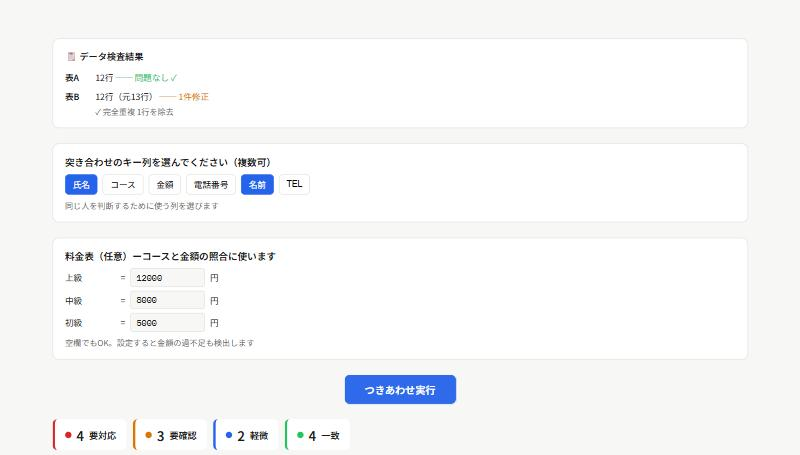
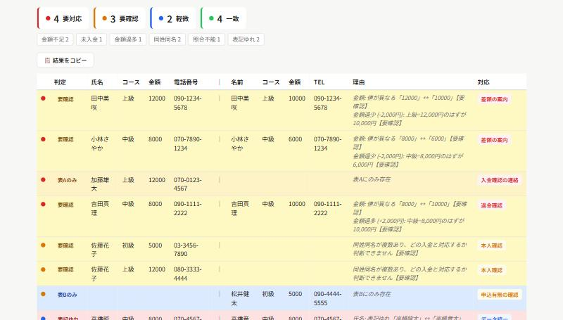
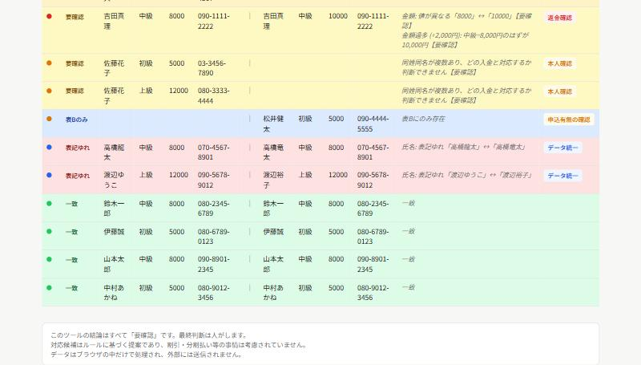

# つきあわせ

2つのCSV表を比較し、違いや確認が必要な項目を整理するツールです。入金記録と申込名簿のつきあわせなど、「2つの表を見比べて、どこが合っていないかを人の目でチェックする」作業を自動化します。

データはすべてブラウザの中だけで処理され、外部(サーバーなど)には送信されません。

## ▶ ツールを開く

[つきあわせを使う](https://ruru105.github.io/work4-tsukiawase/work4-tsukiawase.html)

まずは「サンプルデータで試す」を押して、操作を体験できます。

---

## 目次

- [できること](#できること)
- [判定のしくみ](#判定のしくみ)
- [使い方](#使い方)
- [出力例](#出力例)
- [動作環境](#動作環境)
- [現在の制限](#現在の制限)

---

## できること

- 2つの表(表A・表B)を読み込み、指定したキー列(氏名・電話番号など、複数列の組み合わせも可)で対応する行を自動的に突き合わせ
- 列名が多少違っていても(「氏名」⇔「名前」、「電話番号」⇔「TEL」など)自動でマッチングを試行
- 名前の表記ゆれ(例:「高橋龍太」⇔「高橋竜太」)も検出し、金額などの実質的な不一致と区別して表示
- 料金表(コースと金額の対応)を入力すると、金額の過不足(過少・過多)も自動検出
- 突き合わせ結果を重要度別に自動で仕分けし、件数をカテゴリごとに集計
- 「結果をコピー」で、判定結果をそのまま表やメールなどに貼り付け可能

---

## 判定のしくみ

結果は重要度で色分けされ、それぞれに対応候補が表示されます。

| 重要度 | 主な内容 | 対応候補の例 |
|---|---|---|
| 🔴 要対応 | 表Aにのみ存在(未入金)/ 金額の過少・過多 | 入金確認の連絡 / 差額の案内 / 返金確認 |
| 🟠 要確認 | 表Bにのみ存在(照合不能)/ 値の不一致 / 同姓同名で判断できない / 電話番号の入力ミス | 申込有無の確認 / 内容確認 / 本人確認 / 入力修正 |
| 🔵 軽微 | 名前の表記ゆれ | データ統一 |
| 🟢 一致 | 両方の表でデータが一致 | — |

このツールが示すのはあくまで「対応候補」です。最終的な判断は人が行うものとし、割引・分割払いなど個別の事情は考慮していません。

---

## 使い方

1. 上のリンクからツールを開く
2. 表Aと表B、それぞれにCSVファイルをドラッグ&ドロップ(またはクリックして選択)
3. 「突き合わせのキー列」で、同じ人・同じ対象だと判断するための列を選ぶ(複数選択可)
4. 必要であれば「料金表」にコースごとの金額を入力すると、金額の過不足も検出される
5. 「つきあわせ実行」を押すと、自動で突き合わせと仕分けが行われる
6. 結果は重要度順に色分けして表示。「結果をコピー」でそのまま貼り付け可能

---

## 出力例

### 1. CSVを読み込むと、まず簡単なデータ検査結果が表示される

### 2. 「つきあわせ実行」を押すと、重要度別に色分けされた結果が表示される

### 3. 表記ゆれ・一致した行も含め、全件が一覧で確認できる

画面下部には「このツールの結論はすべて提案であり、最終判断は人が行うこと」「データは外部送信されないこと」が明記されています。

---

## 動作環境

ブラウザだけで完結する1ファイルのツールです。インストールは不要で、最新のChrome・Edge・Safariなどで動作します。データはすべてブラウザ内で処理され、サーバーなど外部への送信は行いません。

---

## 現在の制限

- 突き合わせ結果はあくまで「対応候補」です。最終確認は人が行ってください
- 列名の自動マッチングは、よくある同義語(氏名⇔名前、電話⇔TELなど)に限られます。大きく異なる列名は手動での確認が必要です
- 割引・分割払いなど、料金表だけでは表せない個別の事情は考慮されません
